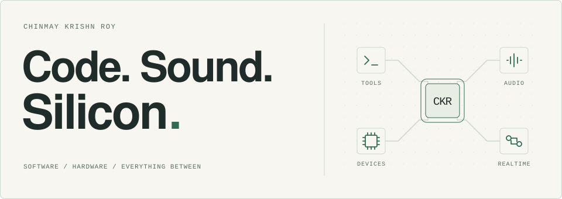

<picture>
  <source media="(prefers-color-scheme: dark) and (max-width: 600px)" srcset="assets/header-mobile-dark.svg">
  <source media="(max-width: 600px)" srcset="assets/header-mobile-light.svg">
  <source media="(prefers-color-scheme: dark)" srcset="assets/header-dark.svg">
  
</picture>

I'm **Chinmay**, a developer from India building developer tools, music software, and connected devices. I like following ideas from interface to hardware.

**Languages I reach for** &nbsp; `Python` · `Go` · `Rust` · `TypeScript` · `C++`

### Building now — [OneMinute ↗︎](https://oneminute.prefect-sys.online)

**Meet the person before you judge the profile.**

A conversation-first social app with people discovery, voice/video calls, messaging, and private, expiring Moments. I'm building the TypeScript interface, Go backend, WebRTC calls, and media pipeline.

`TypeScript` `Go` `WebRTC` `PostgreSQL` `Redis` &nbsp; · &nbsp; **Private source** · [Live development preview](https://oneminute.prefect-sys.online)

### Open source

- **[cxt ↗︎](https://github.com/chinmaykrishnroy/cxt)** — Source context for coding agents, with AST-aware selection, token budgets, CLI, TUI, and MCP. `Rust`
- **[PoKo ↗︎](https://github.com/chinmaykrishnroy/PoKo)** — Video, music, synchronized audio, and OTA updates on an ESP32-S3 with a 128 × 128 display. `C++` `Python`
- **[DeChord Studio ↗︎](https://github.com/chinmaykrishnroy/DeChord)** — A local music practice workspace: chord analysis, guitar voicings, passage loops, and playback transposition. `Python` `TypeScript` `Rust`

I also make electronic music and play guitar & keys.

[All projects](https://github.com/chinmaykrishnroy?tab=repositories) &nbsp; / &nbsp; [LinkedIn](https://www.linkedin.com/in/chinmaykrishnroy/) &nbsp; / &nbsp; [YouTube](https://youtube.com/chinmaykrishnroy)

---

<picture>
  <source media="(prefers-color-scheme: dark)" srcset="https://raw.githubusercontent.com/chinmaykrishnroy/chinmaykrishnroy/output/github-contribution-grid-snake-dark.svg">
  <source media="(prefers-color-scheme: light)" srcset="https://raw.githubusercontent.com/chinmaykrishnroy/chinmaykrishnroy/output/github-contribution-grid-snake.svg">
  
</picture>
