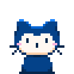

# hey, I'm Chinmay

**I make software, music, and tiny hardware.**

Developer from India. Usually building a tool I wanted, an app I'd use, or making an ESP32 do a little too much.

`Python` · `Go` · `Rust` · `TypeScript` · `C++`

[Projects](https://github.com/chinmaykrishnroy?tab=repositories) &nbsp; / &nbsp; [LinkedIn](https://www.linkedin.com/in/chinmaykrishnroy/) &nbsp; / &nbsp; [YouTube](https://youtube.com/chinmaykrishnroy)

### On my workbench

<a href="https://oneminute.prefect-sys.online">
  <picture>
    <source media="(prefers-color-scheme: dark) and (max-width: 600px)" srcset="assets/header-mobile-dark.svg">
    <source media="(max-width: 600px)" srcset="assets/header-mobile-light.svg">
    <source media="(prefers-color-scheme: dark)" srcset="assets/header-dark.svg">
    
  </picture>
</a>

People discovery, voice/video calls, messaging, and private, expiring Moments. I'm building the interface, Go backend, WebRTC calls, and media pipeline.

`TypeScript` `Go` `WebRTC` `PostgreSQL` `Redis` &nbsp; · &nbsp; **Private source** · [Try the development preview ↗︎](https://oneminute.prefect-sys.online)

### A few things I've built

- **[cxt ↗︎](https://github.com/chinmaykrishnroy/cxt)** — A Rust context engine for coding agents. AST-aware selection, token budgets, CLI, TUI, and MCP.
- **[PoKo ↗︎](https://github.com/chinmaykrishnroy/PoKo)** — A pocket ESP32-S3 media device. Video, music, synchronized audio, and OTA on a 128 × 128 display. `C++` `Python`
- **[DeChord Studio ↗︎](https://github.com/chinmaykrishnroy/DeChord)** — A local music practice workspace for chord analysis, guitar voicings, loops, and transposition. `Python` `TypeScript` `Rust`

When I'm not writing code, I'm making electronic music or playing guitar & keys.

---

<picture>
  <source media="(prefers-color-scheme: dark)" srcset="https://raw.githubusercontent.com/chinmaykrishnroy/chinmaykrishnroy/output/github-contribution-grid-snake-dark.svg">
  <source media="(prefers-color-scheme: light)" srcset="https://raw.githubusercontent.com/chinmaykrishnroy/chinmaykrishnroy/output/github-contribution-grid-snake.svg">
  
</picture>
